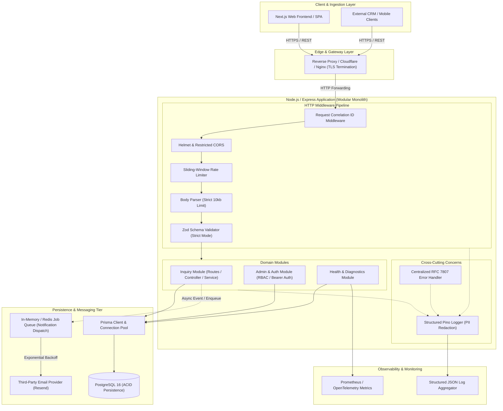

# Target Backend Architecture & System Design

**Project:** Cynbit Inquiry & Applicant Management Platform  
**Architecture Style:** Production-Hardened Modular Monolith  
**Author:** Sankalp (Backend Developer Intern Applicant)  
**Reviewer Perspective:** Senior Backend & Distributed Systems Engineer

---

## 1. Executive Architectural Overview

This architecture provides a scalable, secure, and resilient backend foundation for Cynbit Technologies' public inquiries and career workflows. It replaces tightly coupled server action scripts with a clean, decoupled RESTful API built around a **Modular Monolith** architecture.

### Target Architecture Diagram



---

## 2. Component-by-Component Rationale & Failure Mode Analysis

Every component in this architecture fulfills a concrete production requirement.

### 2.1 Edge & Reverse Proxy Layer (TLS Termination & Gateway)
- **Why it exists:** Provides entry-point security, terminates TLS 1.3, manages SSL certificates, absorbs Layer 3/4 volumetric DDoS attacks, and proxies requests to the backend Node process.
- **Problem it solves:** Offloads CPU-intensive TLS cryptographic handshakes from Node.js event loop threads and shields origin IP addresses.
- **Data Flow:** Incoming TCP 443 requests are decrypted, augmented with forwarding headers (`X-Forwarded-For`, `X-Forwarded-Proto`), and routed over internal private network interfaces to the Node.js port.
- **Failure Mode:** If the edge proxy crashes, traffic drops cleanly at the perimeter with gateway error pages; the internal database remains entirely protected.
- **Initial vs Scaling Necessity:** In initial environments, cloud platform entry points (Vercel/Render/Fly.io) handle this natively. At scale, an explicit Nginx/Cloudflare Enterprise tier is introduced.

### 2.2 Request Correlation ID Middleware (`request-id.ts`)
- **Why it exists:** Generates a deterministic, unique UUIDv4 token for every HTTP transaction.
- **Problem it solves:** Eliminates the "needle in a haystack" problem during production debugging. Unifies client error reports, API gateway logs, Node.js traces, and database query timings under a single correlateable trace identifier.
- **Data Flow:** If incoming request header `X-Request-Id` is present and valid, it is reused; otherwise, a fresh UUIDv4 is generated, assigned to `req.id`, injected into `res.setHeader("X-Request-Id", ...)`, and bound to child Pino log contexts.
- **Failure Mode:** Middleware is in-memory and non-throwing. If crypto UUID generation fails (rare system entropy exhaustion), it falls back to a high-resolution timestamp string.
- **Initial vs Scaling Necessity:** Mandatory from day one. Retrofitting tracing onto legacy uninstrumented systems is notoriously painful.

### 2.3 Security Middleware (`Helmet` & Restricted CORS)
- **Why it exists:** Implements defensive HTTP response headers and enforces Origin verification for cross-site requests.
- **Problem it solves:** Prevents MIME-sniffing (`nosniff`), clickjacking (`frameguard`), removes fingerprinting (`hidePoweredBy` strips `X-Powered-By`), and restricts browser scripting origins to authorized domains (e.g., `https://cynbit.in`, preventing arbitrary third-party web pages from submitting automated authenticated requests).
- **Data Flow:** Evaluates request origin against allowed whitelist; attaches 11+ standard security headers on every outgoing response.
- **Failure Mode:** Disallowed cross-origin requests receive an immediate `403 Forbidden` response without consuming database connections.
- **Initial vs Scaling Necessity:** Mandatory for production.

### 2.4 Sliding-Window Rate Limiter (`express-rate-limit`)
- **Why it exists:** Limits request frequency per IP address (5 requests per 15-minute window for public inquiry creation).
- **Problem it solves:** Protects the platform from automated spam bots, form stuffing attacks, transactional email quota depletion (Resend), and compute exhaustion.
- **Data Flow:** Computes client IP (evaluating trusted proxy headers), queries sliding-window counter, increments count, and either passes control or returns HTTP `429 Too Many Requests` with a `Retry-After` header.
- **Failure Mode:** Standalone instances use an in-memory memory store. If memory runs high or the process restarts, limits reset. In clustered deployments, a Redis store (`rate-limit-redis`) is plugged in without changing middleware logic.
- **Initial vs Scaling Necessity:** In-memory rate limiting is sufficient for a single instance; distributed Redis store is recommended when horizontal scaling exceeds two replicas.

### 2.5 Strict Zod Validation Middleware (`validate.ts`)
- **Why it exists:** Enforces schema contracts at the edge of the application layer before controllers or services execute.
- **Problem it solves:** Frontend HTML validation is trivially bypassed. Malicious or malformed inputs (50MB strings, injection characters, unexpected JSON properties) are caught and discarded immediately.
- **Data Flow:** `req.body` is parsed through `inquirySchema.parse()`. Unknown keys are rejected via `.strict()`. Clean, normalized data is reassigned to `req.body`.
- **Failure Mode:** Schema validation failures throw `ZodError`, captured by the centralized error handler to return HTTP `400 Bad Request` with field-level error messages (`code: "VALIDATION_ERROR"`). No database operation is attempted.
- **Initial vs Scaling Necessity:** Mandatory.

### 2.6 Domain Service Layer (`inquiry.service.ts`)
- **Why it exists:** Isolates core business rules, transactional workflows, and third-party orchestration from HTTP transport logic.
- **Problem it solves:** Prevents controllers from bloating into "god objects" and enables unit testing of business logic without spinning up mock HTTP servers.
- **Data Flow:** Receives validated DTO from controller, sanitizes strings, coordinates repository persistence, and triggers asynchronous notifications.
- **Failure Mode:** If database persistence fails, an error is bubbled up to the controller without triggering notification side effects.
- **Initial vs Scaling Necessity:** Mandatory for maintainability and clean architecture.

### 2.7 Database Persistence & Prisma Connection Pool
- **Why it exists:** Manages relational data persistence, schema migrations, and connection reuse.
- **Problem it solves:** Raw SQL queries are vulnerable to SQL injection and require boilerplate connection handling. Prisma provides fully type-safe, parameterized queries and manages an internal pool of database connections.
- **Data Flow:** Service calls `prisma.inquiry.create({ data })`. Prisma serializes the query into a parameterized SQL statement (`INSERT INTO "Inquiry" ("id", "name", "email", ...) VALUES ($1, $2, $3, ...)`), executes it against an available pooled connection, and returns a typed model entity.
- **Failure Mode:** If the database becomes unavailable, the connection pool rejects queries with a connectivity exception, caught by the repository and mapped to a safe `DATABASE_ERROR` (HTTP 500) without leaking credentials or table names to the client.
- **Initial vs Scaling Necessity:** Mandatory.

### 2.8 Asynchronous Notification Dispatch (Decoupled Background Queue)
- **Why it exists:** Decouples user HTTP responses from third-party API communication (Resend).
- **Problem it solves:** Calling Resend's REST API synchronously within the client request cycle adds 300ms–2000ms of latency and creates an external point of failure: if Resend times out, the user's form submission errors out even if data was successfully saved.
- **Data Flow:** The inquiry is durably saved to PostgreSQL first. An asynchronous job is dispatched outside the request-response path. The HTTP 201 response is returned to the user in < 50ms. The background worker attempts delivery with exponential backoff retries.
- **Failure Mode:** If Resend is down, the background worker retries 3 times before placing the job into a Dead-Letter Queue (DLQ) for alerting. The user's inquiry is safe and never lost.
- **Initial vs Scaling Necessity:** An in-process decoupled asynchronous dispatcher is ideal for initial workloads; a dedicated message queue (BullMQ + Redis) is introduced when background job volume exceeds 1,000 jobs/minute.

### 2.9 Centralized Error Handling Middleware (`error-handler.ts`)
- **Why it exists:** Acts as the single safety net catching all rejected promises and synchronous exceptions across the Express app.
- **Problem it solves:** Prevents unhandled exceptions from terminating the Node process and guarantees that database errors, internal paths, and stack traces are never disclosed to clients in production.
- **Data Flow:** Catches errors, checks `err instanceof AppError` or `err instanceof ZodError`, logs detailed diagnostic information with request correlation ID, and returns an RFC 7807-compliant JSON response.
- **Failure Mode:** Catches all unknown errors, returning a standard HTTP `500 Internal Server Error` with code `INTERNAL_SERVER_ERROR`.
- **Initial vs Scaling Necessity:** Mandatory from inception.

---

## 3. Modular Monolith vs Microservices Justification

### Why a Modular Monolith is the Right Choice for Cynbit
For a growing tech company handling public corporate inquiries, portfolio showcases, and career applications, a **Modular Monolith** is vastly superior to microservices:

1. **Operational Simplicity:**  
   Microservices require service discovery, distributed tracing, network mesh (Istio/Linkerd), cross-service authentication, and complex deployment pipelines. A modular monolith runs as a single deployable artifact on standard infrastructure, allowing engineers to focus on business features rather than distributed systems plumbing.
2. **ACID Transactions Without Distributed Sagas:**  
   Inquiries and applicant submissions require strict database integrity. In a monolith, operations execute within a single PostgreSQL ACID transaction. In microservices, multi-service transactions require complex Saga patterns or two-phase commit (2PC) mechanisms.
3. **Zero Network Serialization Overhead:**  
   Communication between modules occurs via in-process TypeScript function calls (`inquiryService.createInquiry(...)`) with zero latency, zero network hops, and compile-time type safety.
4. **Clean Domain Boundaries:**  
   By strictly separating modules into discrete directories (`modules/inquiry`, `modules/careers`, `modules/admin`) with clear internal interfaces, the codebase retains all organizational benefits of microservices without the operational tax. If a specific module (e.g., AI resume parsing) eventually requires independent scaling, it can be extracted into a standalone service with minimal refactoring.

### Why Kubernetes, Kafka, and Redis are Intentionally Excluded at this Stage
- **Kubernetes (K8s):** Introduces steep operational overhead (etcd clusters, ingress controllers, pod topology spread constraints). Modern container platforms (Fly.io, AWS ECS, Google Cloud Run) provide zero-maintenance auto-scaling at a fraction of the operational cost.
- **Apache Kafka:** Designed for millions of events per second with multi-broker cluster management. For inquiry submissions (hundreds or thousands per day), Kafka is massive over-engineering. An in-process event emitter or lightweight Redis BullMQ worker is vastly simpler and cheaper.
- **Premature Distributed Caching:** The inquiry workflow is write-heavy (inserting new inquiries) and rarely reads stale public records. Adding Redis caching here would introduce cache invalidation bugs without measurable performance gains.

---

## 4. Scalability & Evolution Roadmap

When Cynbit scales from thousands to millions of requests, the architecture evolves cleanly through these sequential milestones:

```
[Phase 1: Current Architecture]
Modular Monolith + PostgreSQL Connection Pool + In-Process Async Worker
└── Capacity: 0 to 500 req/sec | Cost: Low | Maintenance: Zero

[Phase 2: Scale Horizon 1 - Multi-Replica Clustered Monolith]
Docker Containers behind Cloudflare / Nginx + Redis (Distributed Rate Limit & BullMQ)
└── Capacity: 500 to 5,000 req/sec | Zero architectural rewrites

[Phase 3: Scale Horizon 2 - Selective Service Extraction]
Monolith core + Event-Driven Microservice for high-compute AI workflows (e.g., AI Resume Analyzer)
└── Capacity: 5,000+ req/sec | Scaled strictly where compute bottleneck exists
```
